# Yonder: design document

This document describes Yonder 0.1.42. It tells you how Yonder works as one system. It shows each part, the function of each part, and the connections between the parts.

The text follows the rules of ASD-STE100 Simplified Technical English: short sentences, the active voice, and one name for one thing. No STE checker examined the text.

The document describes the code in this repository. The website and the settings of Yonder's own servers are not in this repository, and this document does not describe them. A PDF of this document is adjacent to it: `design.pdf`.

## Contents

1. Purpose
2. Terms
3. System overview
4. The layers that carry a file
5. The devices
6. The LocalSend side on the local network
7. The tunnel
8. The data channel: a transfer with a web app
9. Pairing
10. Presence and the address refresh
11. How Yonder selects the path for a send
12. The web app
13. The server programs
14. The code
15. Security summary
16. Known limits

## 1. Purpose

Yonder sends files between two devices. The devices can be on one network or on different networks. The user does not make an account. No server keeps the files, and no server carries them.

Yonder has one firm requirement: it must operate with no setup. The user does not open a port. The user does not change a router. The user does not start a second program. The user pairs two devices one time. After that, each device finds the other from all networks.

Yonder joins two designs that exist:

- **The LocalSend protocol** moves the files. Thus a Yonder app also exchanges files with a LocalSend app on the same network.
- **tailcat** makes an encrypted tunnel between two devices on different networks. tailcat is an open-source Go library from Tailscale.

The primary design decision is this: Yonder does not change the LocalSend protocol. Yonder sends the same requests through the tunnel. Thus one receiver handles local senders and remote senders with the same code.

The second design decision is this: no file goes through a server of Yonder. Between two networks, a file goes directly from one device to the other. If the two networks permit no direct connection, the send stops, and Yonder tells the user.

## 2. Terms

| Term | Meaning |
|---|---|
| Device | A computer or a phone on which Yonder operates |
| App | Yonder as a desktop program (Linux, Windows, macOS) |
| Web app | Yonder as a web page, at `https://app.getyonder.org/` |
| LocalSend app | The initial LocalSend program. It is not a part of Yonder. |
| Fingerprint | The SHA-256 hash of the TLS certificate of a device. It is the identity of the device. |
| Tunnel | An encrypted connection between two devices, which tailcat makes |
| Tunnel address | A long text that gives the keys and the relay of one device. It is a secret. |
| Client key | The key with which a device connects to the tunnel of a different device. It is not a secret. |
| Relay | A server program that passes encrypted tunnel packets between two devices |
| Main relay | The relay `relay.getyonder.org`. It is always the first relay in the list of relays. |
| List of relays | The relays that Yonder can use |
| Home relay | The relay in the list that the tunnel address of a device points at |
| Direct path | A tunnel path between two devices that does not go through a relay |
| Fetched send | A send in which the receiver gets the files on its own tunnel connection to the sender (section 7.6) |
| Data channel | A direct connection between two devices that WebRTC makes. A transfer with a web app uses it (section 8). |
| Description | The text that one device gives the other to make a data channel: its possible addresses and the fingerprint of its DTLS key |
| STUN server | A server that tells a device its public address. It carries no file. |
| Service | The things that a Yonder asks Yonder's server for: the meeting point, the list of relays, and the update check. Its host name is `api.getyonder.org`. |
| Application server | The server program `yonder-api`. It supplies the service and nothing else. |
| Meeting point | The part of the application server that tells devices at the same public address about each other, and devices in the same room |
| Room | A group of two devices at the meeting point. The two devices come with the same room code. |
| Room code | The six digits that the meeting point gives to a room. One user tells the code to the other user. |
| Compared code | The six digits that two devices calculate from their shared secret. The two owners compare them. |
| Pairing | The procedure in which two devices exchange their records |
| Record | The data that one paired device keeps about the other: name, fingerprint, tunnel address, client key |
| Paired device | A device of which this device has a record |
| Nearby device | A device that this device found on the local network or through the meeting point |
| Website | The pages at `getyonder.org`. It has pages only. No Yonder needs it. |

## 3. System overview

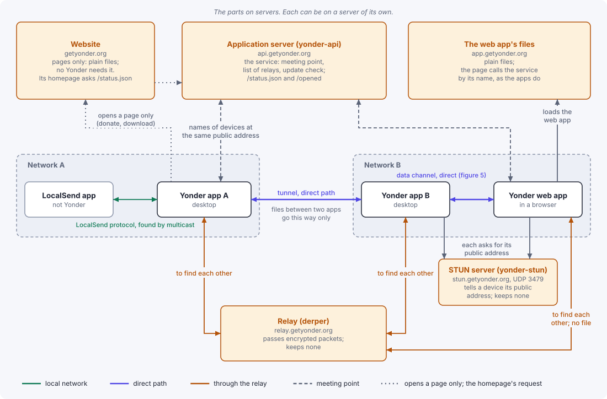

*Figure 1. The devices, the networks, and the parts that operate on servers. Each colour shows one type of connection. The meeting point line is shown for app A and for the web app; app B has the same line as app A. The data channel is shown between app B and the web app; a web app makes one with each paired device, on each network.*

The system has three types of device, and five parts that operate on servers.

| Part | Function | Location |
|---|---|---|
| App | Sends and receives files. Finds devices on the local network. | The device of the user |
| Web app | Sends and receives files in a browser. No installation is necessary. | A browser |
| LocalSend app | Exchanges files with an app on the same network | The device of a different person |
| Relay | Helps two devices to find each other. Passes the small messages of a tunnel when no direct path is available. It carries no file. | `relay.getyonder.org` |
| Application server | Supplies the service to each Yonder. The meeting point is a part of it. | `api.getyonder.org` |
| STUN server | Tells a device its public address before a data channel | `stun.getyonder.org` |
| Files of the web app | The page and the program that a browser loads. They are plain files. | `app.getyonder.org` |
| Website | The homepage and the other pages. No Yonder needs it. | `getyonder.org` |

The app and the web app use the same Go code and the same interface files (section 12).

There are five types of connection:

1. **Local network (green).** An app speaks the LocalSend protocol directly to a device on the same network.
2. **Tunnel, direct path (indigo).** Two apps on different networks send files through a tunnel that goes directly between them.
3. **Tunnel through the relay (amber).** Each tunnel connection starts through the relay. Two apps use the relay only to find a direct path. The tunnel connection of a web app stays on the relay, and it carries only small messages: the presence, the pairing, and the two descriptions for a data channel. No file goes through the relay.
4. **Data channel (indigo).** A transfer with a web app at one end goes on a data channel, directly between the two devices (section 8).
5. **Meeting point (grey, dashed).** Each Yonder tells the meeting point its name. The meeting point sends back the names of the devices at the same public address.

One more line in the figure (grey, dotted) is not a connection of Yonder. It shows a link that only opens a page of the website in a browser, and the one request that the homepage of the website makes (section 13.1).

### 3.1 The parts on servers

Each part can be on a server of its own.

| Part | Program | Host name | Function |
|---|---|---|---|
| Relay | `derper`, a program from Tailscale. Yonder does not change it. | `relay.getyonder.org` | Passes the encrypted packets of a tunnel when no direct path is available |
| Application server | `yonder-api` (`cmd/yonder-api`) | `api.getyonder.org` | The service: the meeting point with its rooms, the list of relays, and the update check with the list of withdrawn versions |
| STUN server | `yonder-stun` (`cmd/yonder-stun`) | `stun.getyonder.org` | Tells a device its public address |
| Files of the web app | A web server, with plain files | `app.getyonder.org` | The page, its scripts and styles, and the program `yonder.wasm`. No program of Yonder is behind this name. |
| Website | A web server, with plain files | `getyonder.org` | The homepage, the help page, the donate page and the privacy page |

Each part has a limit to its function.

| Part | What the part does not do |
|---|---|
| Relay | It pairs no devices. It keeps no packet. It supplies no page and no list. It carries no file. |
| Application server | It supplies no page of the website and no file of the web app. It carries no file and no tunnel packet. |
| STUN server | It answers one type of request with one address. It keeps no address. |
| Files of the web app | They are files only. The page calls the service from the browser of the person, as an app does. |
| Website | It supplies nothing that an app or a web app needs. |

**The web app is a part of the application.** It is not a part of the website. The server that supplies the files of the web app decides which code operates in the browser of a person. A pairing link opens the web app. Thus the web app has a host name of its own, and the website cannot change its files.

**The web app is a client of the service, as the apps are.** The web app is Yonder itself in a browser: files that each server of files can supply, which call `api.getyonder.org` by name.

**The website is not a dependency.** If the website does not operate, each item of this list continues to operate:

- Each app and each web app finds nearby devices.
- Two devices pair by link and by code.
- A device sends files.
- An app gets the list of relays and does the update check.

### 3.2 The addresses in the app

Each app contains the addresses of Yonder's servers. An installed app continues to call the addresses of its build. One package has the addresses, `internal/address`. The name of the main relay is in `tunnel.Relay`.

| Use | Address | In the code |
|---|---|---|
| Meeting point and rooms | `wss://api.getyonder.org/nearby` | `nearby.DefaultURL` |
| List of relays | `https://api.getyonder.org/relays.json` | `tunnel.ListURL` |
| Update check and list of withdrawn versions | `https://api.getyonder.org/latest.json` | `latestURL` in `internal/gui` |
| Pairing link and QR code | `https://app.getyonder.org/#pair=…` | `linkPrefix` in `internal/pairing` |
| Main relay | `relay.getyonder.org` | `tunnel.Relay` |
| STUN server | `stun.getyonder.org`, UDP port 3479 | `stunServer` in `internal/app/channel.go` |

The web app uses the same address of the meeting point and the same STUN server. It does not get the list of relays, and it does no update check.

These links only open a page of the website in a browser.

| Link | Address |
|---|---|
| Donate page | `https://getyonder.org/donate/` |
| Download page | `https://getyonder.org/#download`, from "Get it" in the update notice (section 5.4) |
| Homepage | `https://getyonder.org/`, from the mark in the header of the web app |

If the website does not operate, such a link fails, and Yonder operates as before.

**A copy of the web app with a different service.** At each start, the page reads the file `service.json`, which is adjacent to the page. The file can give the address of a service: `{"service": "https://name"}`. Then the page calls that service. The script `packaging/webapp.sh` writes this file with the contents `{}`, which give no service, and the page then calls `api.getyonder.org`. The file gives no new power to a host: the host of the page already selects the code of the page. Section 13.5 tells what a copy of Yonder with servers of its own needs.

### 3.3 One meeting point, relays by region

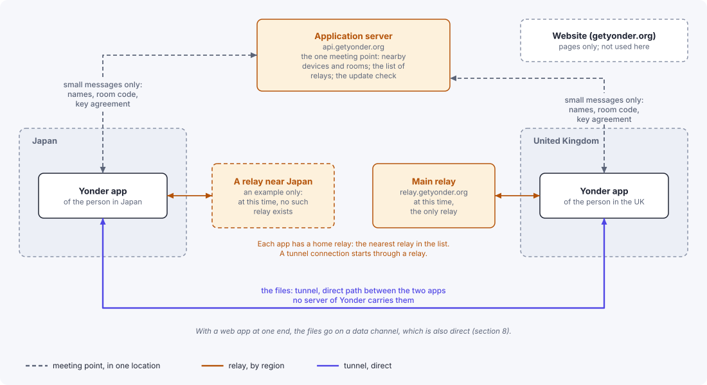

*Figure 2. A person in Japan and a person in the United Kingdom. The relay near Japan is an example only: at this time, the main relay is the only relay.*

Yonder has one meeting point. It does not have one meeting point for each region. The two devices of a room must connect to the same server, and the same is true for two nearby devices. If each region had a meeting point, two devices in different regions could not find each other there. The meeting point passes only small messages, thus one location is sufficient.

The relays are the part that Yonder can put in different regions. Each tunnel connection starts through a relay, thus the distance to the relay has an effect on the time that a connection needs. Each device selects the nearest relay in the list as its home relay (section 7.2).

Example: a person in Japan and a person in the United Kingdom pair their apps by code and send files.

| What | Where it goes |
|---|---|
| The names of nearby devices, the room code, and the key agreement of a pairing | From each device to the application server |
| The list of relays and the update check | From each app to the application server |
| The start of each tunnel connection | Through a home relay |
| The files, between two apps | Directly between Japan and the United Kingdom, on the direct path. No server of Yonder carries them. |
| The files, with a web app at one end | Directly between the two devices, on a data channel (section 8). No server of Yonder carries them. |

## 4. The layers that carry a file

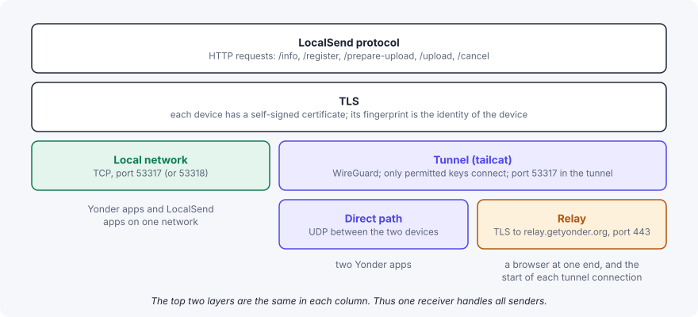

*Figure 3. The LocalSend protocol and TLS are the same on each path. Only the layers below them change.*

A file transfer always uses the same two top layers:

- **The LocalSend protocol** (version 2) is a set of HTTP requests. The sender offers the files with `/prepare-upload`. The receiver accepts or declines. Then the sender sends each file with `/upload`.
- **TLS** protects each request. Each device has a self-signed certificate. The receiver asks the sender for its certificate. Thus each end knows the fingerprint of the other end.

Below these layers, there are three alternatives:

- **On the local network**, the requests go through TCP to port 53317. If a different program has port 53317, Yonder uses port 53318.
- **Through the tunnel**, the requests go to port 53317 in the tunnel. The tunnel is a WireGuard connection. It lets in only the client keys that the device permits. The tunnel packets go on the direct path (UDP) or through the relay.
- **On a data channel**, in a transfer with a web app, the requests go through DTLS on a direct connection that WebRTC makes (section 8).

Thus a file that goes through the tunnel has two layers of encryption: TLS in WireGuard. A file on a data channel also has two layers: TLS in DTLS. The relay has no keys for these layers.

## 5. The devices

### 5.1 Identity of a device

Each device has two identities. The two stay the same until the user removes the data of Yonder.

| Identity | What it is | Function |
|---|---|---|
| Certificate | A self-signed TLS certificate and its private key | Proves which device sends or receives a file. Its fingerprint identifies the device on all paths. |
| Tunnel keys | A server key, a pre-shared key, and a client key | The server key and the pre-shared key, with the home relay, make the tunnel address. The client key identifies the device when it connects to a different device. |

A receiver identifies a paired sender by the certificate that the sender proves it has. The receiver does not trust the name or the fingerprint that an offer contains. "Always accept" applies only to a sender that the receiver identified in this way.

### 5.2 Stored data

The app keeps its data in the folder `yonder` in the configuration folder of the user (on Linux: `~/.config/yonder/`). Only the owner can read the files.

| File | Contents |
|---|---|
| `cert.pem`, `key.pem` | The certificate and its private key |
| `tunnel.json` | The tunnel keys and the home relay. These are secret. |
| `devices.json` | The records of the paired devices. The tunnel addresses in it are secret. |
| `settings.json` | The name, the save folder, the "always accept" list, the names that the owner gave to paired devices, and the selections for the check for a new version (section 5.4) |
| `relays.json` | The last list of relays that the app got from the application server (section 7.2) |
| `withdrawn.json` | The last file about the newest version that had a list of withdrawn versions which the app accepted (section 5.4) |
| `send.log` | The send log |

The app writes `devices.json` and `tunnel.json` by way of a temporary file. It makes the temporary file only if no file with that name exists. Thus a file that a different program put there cannot give its mode to the new file.

**The send log.** The send log has one line with the time for each step of a send between paired devices, and lines for each offer that the device gets. It contains the names of devices, the number of files, the sizes of files, the speed of each file, the path of the transfer, and the cause of the end of a transfer. It contains no file name and no secret. The file has a maximum size of 1 MB; then the app empties it. These rules keep a different device from changing the log: one line has a maximum of 2000 bytes; a control character becomes a space, thus each entry is one line; a name from a different device is in quotation marks, with a maximum of 100 characters; a refusal from a different device is written as its status code, without its text; and an error about a file is written without the name and the path of the file.

The web app keeps the same files in the storage of the browser (section 12). A browser keeps no send log between visits.

### 5.3 The app

The app is a native window with a tray icon. When the user closes the window, the app continues to receive files. Only "Quit Yonder" in the tray menu stops the app. The window shows the version number adjacent to the name "Yonder".

At the start, the app does these steps:

1. It loads or makes the certificate and the tunnel keys.
2. It starts the LocalSend receiver on the local network.
3. It starts discovery on the local network.
4. It opens its permanent tunnel. The tunnel lets in the client keys of the paired devices, and its own client key. Its own key keeps the list from being empty, because tailcat reads an empty list as "all keys".
5. It connects to the meeting point, if the setting "Show this device to others on the same network" is on.

Only one copy of the app operates at a time. A second copy that the user starts tells the first copy and stops, and the first copy shows its window. The second copy also gives its version. If the second copy is newer, the first copy shows a notice: "Yonder (new version) was started, but this older one is still running", with the buttons "Quit Yonder" and "Not now".

Each 30 seconds, the app asks each device in its list if it is there. It asks a nearby device with `/register`. It asks a paired device with `/info` through the tunnel. A nearby device that does not answer two times goes out of the list.

### 5.4 The check for a new version

The app can tell the user that a newer version of Yonder is available. It does not download and does not install the new version.

1. The app asks the application server for the file `https://api.getyonder.org/latest.json`. It asks 10 seconds after the start, and then one time each 24 hours.
2. The file gives the newest version and the address of the download page. The app accepts only three numbers with points between them as a version.
3. The app compares the version in the file with its own version, number by number.
4. If the version in the file is newer, the app shows a notice at the top of "Devices": "Yonder (version) is out".
5. "Get it" opens the download page in the browser. The app opens the address in the file only if it is an `https://` address at the host name of the website (`ownPage` in `internal/gui/update.go`). If it is not, the app opens the download page whose address is in the code.
6. "Not now" removes the notice. The app stores this version in `settings.json`. The notice comes back only for a version that is newer than the stored version.

The request gives the version of the app and its system in the `User-Agent` line, for example `Yonder/0.1.42 (linux)`. The system is `windows`, `macos` or `linux`. The request contains no name and no identifier of the device. The server uses the two values for its daily totals (section 13.2). One function makes this text (`Name` in `internal/tally/agent`), and it is adjacent to the function of the server that reads it. If the request fails, the app shows nothing and asks again after 24 hours.

The setting "Tell me when a new version is out" is on by default. When it is off, the app sends no request.

The web app does not do this check, because the browser loads the newest web app at each visit.

#### Withdrawn versions

The app can tell the user that its version is withdrawn. A withdrawn version is a version with a fault that its users must know about. The notice only warns. The app continues to operate, and nothing stops a send.

**The list.** The file `latest.json` has two more fields. The app reads a maximum of 64 KB of the file.

```json
{
  "version": "0.1.42",
  "page": "https://getyonder.org/#download",
  "withdrawn": "<the bytes of the list, in base64>",
  "signature": "<the Ed25519 signature of those bytes, in base64>"
}
```

The bytes of the list are JSON:

```json
{
  "made": "2026-12-01T10:00:00Z",
  "versions": [
    { "version": "0.1.50", "systems": ["windows"] },
    { "below": "0.1.45" }
  ]
}
```

- An entry gives one `version`, or all versions `below` one version.
- `systems` gives the systems that the entry is for: `windows`, `macos` or `linux`. An entry without `systems` is for all systems.
- `made` is the time of the signature.
- The list gives no reason.

The versions in this example are examples only. At this time, the list has no entries.

**The rules of the app** (`internal/withdrawn` and `internal/gui/withdrawn.go`):

1. The app examines the signature with the public key in its code. The signature is for the same bytes that the app reads. If the signature is not correct, the app ignores the list.
2. The app ignores a list that is older than the list that it has. Thus an old list that a server sends again has no effect.
3. A file with no list changes nothing. Only a newer list removes a notice. A newer list with no entries removes all notices.
4. The app keeps the file with the last accepted list in `withdrawn.json`. After a start with no network, the app reads this file and examines the signature again. Thus the notice shows immediately, and the rule about older lists continues to apply.
5. A development build is never withdrawn. A development build has a version that is not three numbers.
6. `version` and `page` are not signed. A person who controls the application server can change them: the update notice can then give an incorrect version, but its button opens only a page of the website. Such a person cannot make the withdrawn notice show and cannot remove it.

**The notice.** It is a card with a red border at the top of "Devices": "Yonder (version) has been withdrawn". It has no "Not now", and the user cannot remove it.

- If a newer version is available that is not withdrawn for this system, the notice tells the user to get that version, and its button opens the download page.
- If no such version is available, the text is "A new version is not out yet. Until it is, use this one at your own risk." There is no button.
- While this notice shows, the notice "Yonder (version) is out" does not show.

When the setting "Tell me when a new version is out" is off, the app sends no request. It then shows no notice, also not from a list that it kept before. The settings page says this below the setting.

**The key.** The key is an Ed25519 key. The public half is in `internal/withdrawn/withdrawn.go`. The private half is not on a server and not in the repository. If the key is lost, no version can be withdrawn until a version of Yonder with a new key is released. If a person gets the key and also controls the application server, that person can show the notice. That person cannot install or stop a program.

**The tool.** The program `yonder-withdraw` (`cmd/yonder-withdraw`) signs the list. The entries are in `packaging/withdrawn.list.json`, and the signed list is in `packaging/withdrawn.json`. The repository keeps the two files, thus its history shows each withdrawal. The tool reads the private key from the environment at the moment of the signature. It refuses a private key that is not the pair of the public key in the code, and it refuses to make a list that is not later than the list in the file. The script `packaging/api.sh` calls `yonder-withdraw -latest <version>`, which writes `latest.json` with the list and needs no key. The command stops if the signature is not correct. The apps get a new list in a maximum of 24 hours.

### 5.5 The terminal commands

The program `yonder` also has commands for a terminal. The top of `cmd/yonder/main.go` lists all of them. Two commands are for other programs to operate Yonder:

| Command | Function |
|---|---|
| `yonder devices -json` | Prints the name of this device and the list of its devices as JSON. The list has the paired devices and the nearby devices. |
| `yonder send DEVICE FILE...` | Sends files to the device with this name, or with this name from the owner. |
| `yonder send -id ID FILE...` | Sends files to the device with this ID. Two devices can have the same name, but not the same ID. |

**The commands ask the app.** While it operates, the app listens on a socket. The socket is a file in the runtime folder of the user (`$XDG_RUNTIME_DIR`). If there is none, the socket is in a folder of its own in the temporary folder, `yonder-<user number>`, with mode 700. The app and the commands do not use that folder if a different user owns it, if other users can open it, or if it is a link. On Windows, the folder is `Yonder` in the local application data of the user (`%LocalAppData%`). The name of the socket comes from the settings folder, so each settings folder has its own socket. Only the owner can open the socket. A request to the socket has a size limit of 1 MB, and a connection that sends nothing is closed. The two commands first connect to the socket:

- If the app answers, the app does the work. `devices` gets the list that the window shows. `send` starts a transfer in the app, and the window shows the transfer. The command waits until the transfer is done, then prints the result that the window shows. If the command stops before that, the transfer continues.
- If no app answers, the command starts a Yonder of its own for this one task. For the list, it asks each paired device, and waits 2 seconds for nearby devices. The field `running` in the JSON is `false`.

With `-app`, `devices` asks only the app. If no app operates, it prints an empty list immediately.

The reason for the socket is that two Yonders with the same identity operate badly together. Each has its own listener and its own tunnel connections with the same keys.

The JSON has the field `version`, at this time `1`. Later versions can add fields. They do not change the name or the meaning of a field unless `version` changes. Each device has these fields: `id`, `name`, `label` (the name from the owner), `model`, `paired`, `nearby`, `presence` (`online`, `offline` or `checking`), `always`, `pairable` (seen through the meeting point, but not paired, so files cannot go to it), and `localsend`. The list also gives the version of the app (the field `app`).

The socket carries HTTP with JSON. A transfer that starts through the socket obeys all the rules of a transfer that starts in the window (sections 7.5 and 11).

A command that starts a Yonder of its own does not open the permanent tunnel. Thus a paired device cannot connect to it, and it sends to a paired device only on its own connection: it does not use the fetched send (section 7.6).

## 6. The LocalSend side on the local network

The app is a full LocalSend device on the local network. A LocalSend app sees the Yonder app as one more LocalSend device.

### 6.1 Discovery

1. The app sends an announcement to a multicast group on UDP port 53317. It uses IPv4 (`224.0.0.167`) and IPv6 (`ff12::fd3a:e420`).
2. Each device that hears the announcement answers with a `/register` request to the app.
3. The app sends the announcement again each 30 seconds. Thus a lost message is corrected in half a minute.

The app does not examine all addresses of the subnet. LocalSend does this as a last step, and Yonder does not.

**What the app believes.** Each device on the local network can send an announcement that contains the fingerprint of a different device. Thus the app obeys three rules. They are in `Registry` in `internal/localsend`.

1. An announcement tells if the device uses TLS (`https`) or does not use TLS (`http`). A device that the app saw with TLS stays a device with TLS. The app ignores an announcement that says that such a device does not use TLS.
2. The app lists a paired device only with TLS. If an announcement without TLS contains the fingerprint of a paired device, the app does not list it as a nearby device.
3. After the app reached a device, the name and the port of that device change only when the announcement comes from a confirmed address. A confirmed address is an address at which the app reached the device.

If the app saw a device only without TLS, and then an announcement says that the device uses TLS, the app discards the addresses that it kept for that device.

A LocalSend app whose encryption is set to off announces `http`. The app lists such a device with the tag "Not encrypted".

**What the app keeps.** A device on the local network tells its name in an announcement or in a `/register` request. No rule of the protocol limits this text. Thus the app obeys four more rules.

1. The app reads a maximum of 16 KB of a `/register` request.
2. Each name goes through the rule for names, `names.Clean` in `internal/names`. The rule removes control characters and characters that change the direction of the text. It removes spaces at the two ends. It keeps a maximum of 64 characters. The app applies the rule to the name, the model, the type, the version and the protocol of the device. The function `Info.cleaned` in `internal/localsend` does this for an announcement, for a `/register` request and for an offer.
3. The app keeps a fingerprint fully or not at all. It ignores a device whose fingerprint is longer than 128 characters or contains one of the removed characters.
4. One address can add a maximum of 16 devices to the list of nearby devices. The list has a maximum of 1024 devices.

**The row of a paired device.** The row of a paired device shows the name from its pairing record. An announcement with the fingerprint of a paired device does not change the name, and it does not change the model. It only shows that the device is nearby. A paired device tells a new name through the tunnel (section 10.1).

**Limits of discovery.** When the list of nearby devices is full, a new device replaces a device that was silent for 10 minutes or more. The app handles a maximum of 32 announcements at the same time. It answers an announcement only when the announcement comes from a local address and names a port from 1024 to 65535.

### 6.2 Addresses of a nearby device

The app keeps a maximum of 8 addresses for each nearby device. It puts them in this sequence:

1. Addresses at which a connection did not fail
2. Addresses that the app reached itself
3. IPv6 addresses
4. The newest addresses

When the app sends, it tries the addresses in sequence. It waits 1.5 seconds for each address, and 10 seconds for the last address. An address is good only if the certificate of the correct device answers there. One function contains this rule: `Sender.connect` in `internal/localsend`.

### 6.3 Transfer

1. The sender sends the offer (`/prepare-upload`): its own data and the list of files.
2. The receiver shows the offer to its owner. The owner accepts or declines. If "Always accept" is set for a paired sender, the receiver accepts immediately.
3. The sender sends each file (`/upload`). The two devices show the progress.
4. The app writes each file to the save folder. It writes a part file first, and gives the file its name when the file is complete.

The sender or the receiver can stop a transfer with `/cancel`.

**The progress that the sender shows.** The sender counts the bytes of a file when it gives them to the connection, not when they arrive. The connection takes the bytes in bursts, with a pause between two bursts. Thus the count stops and then jumps, and it is ahead of the receiver. The window does not show the count directly. It shows a value that follows the count in small steps: it divides each jump across approximately two times the pause between the bursts, with a maximum of 3 seconds. The value does not go past the count and does not go back. The speed and the time that remains come from the value that the window shows. This rule is in one file, `internal/gui/ease.go`.

**The end of a send.** When the value that the window shows is equal to the total, all the bytes are out of the program, but the last bytes can be on their way. The window then does not show a full bar. It shows the moving bar and the text "Waiting for (name) to receive the last of it…" until the receiver answers.

**Limits of the receiver.** These limits keep one device from stopping the receiver or filling the memory of the computer.

| Item | Limit |
|---|---|
| Size of one offer | 1 MB |
| Files in one offer | 1000 |
| Size of one preview picture | 64 KB. A larger preview is discarded, and the file stays in the offer. |
| Time to send one offer | 30 seconds |
| Offers that the app reads at the same time | 16, and one for each address |
| Offers from one address that the owner is asked about | 5 each minute |
| Offers for a fetched send from one address that the app refuses because there is no direct path (section 7.6) | 3 each minute, counted apart from the 5. Then the app refuses each offer for a fetched send from that address with status 429, until a minute has gone. |
| Time for the owner to answer | 5 minutes. Then the app declines the offer. |
| Time for the headers of a request, and time of a connection without a request | 20 seconds, and 2 minutes |
| Time that a file can arrive with no new data | 1 minute. Then the app stops the transfer, removes the incomplete file, and can receive again. |

The receiver can do one transfer at a time. It reads an offer before it gives the transfer to the sender. Thus a sender that sends its offer slowly does not keep other senders out.

**What a sender can send.** A send takes only ordinary files. A link to an ordinary file is an ordinary file. The app refuses a folder, a named pipe and a device file before it makes the offer, because some of these never give their data.

**The notification of an offer.** The notification shows the name of the sender and the name of the first file. The app removes `<`, `>` and control characters from this text, and it shows a maximum of 100 characters of the title and 200 characters of the body. Thus a sender cannot put markup in a notification.

**File names.** A file name from a sender cannot go out of the save folder. The app refuses an offer that contains one of these names: a name that Windows keeps for a device (for example `CON` or `COM1`), a name with a colon, a name that ends with a dot or a space, a name with a control character or a character that changes the direction of the text, and a name that is too long for a disk (a part of more than 255 bytes, or a full name of more than 1024 bytes). If a part of a name starts with a dot, the app replaces the dot with `_`. Thus a received file is not hidden, and it cannot go into a folder such as `.config`. The question shows each file name fully, thus the name that the user reads is the name on the disk. The app never writes over a file: a second file of the same name gets a number in its name.

**Names that the app shows.** Each name that comes from a different device goes through the rule for names (`names.Clean`, section 6.1) before the app keeps it or shows it. This applies to the name of the sender in the question, the name of a nearby device, the name of a device at the meeting point (section 9.2), and the name in a pairing record. The characters that the rule removes are the same characters that make the app refuse a file name (`names.Bad`).

**The question and "Open".** The question shows the tag "Unverified device" when the sender is not a paired device, and the notification says "(unverified device)" after the name of the sender. The name in the question is the name that the sender gives, and a sender that is not paired can give any name. For a received file that the system would run (a program, a script, a shortcut, an installer, a disk image), the button says "Show" and opens the folder of the file. For all other files, the button says "Open". One function contains this rule: `runsWhenOpened` in `internal/gui`.

**A device with the tag "Not encrypted".** The app sends to such a device without TLS. No certificate proves which device is at the address, and a computer on the same network can read the files. The rule of section 6.2 for a good address does not apply: the app uses the first address that answers. The tag is the only warning. The app does not ask the user again before it sends.

### 6.4 The firewall notice

A firewall can keep other devices out when the app can still send. The app shows a notice when it finds that a firewall blocks it. A second Yonder can do a check through the meeting point: it tries to connect to the first device on the local network and reports the result. The second Yonder says "yes" only when the certificate of the first device answers. Thus the check cannot examine other computers.

## 7. The tunnel

### 7.1 What tailcat supplies

tailcat makes a WireGuard connection between two programs. It operates fully in the program: it needs no administrator rights and makes no changes to the network of the operating system.

Only the package `internal/tunnel` uses tailcat, because the interface of tailcat can change. All other packages see a listener and a dialler. The version of tailcat is fixed at v0.7.0, with the module `tailscale.com` at v1.104.7. The module makes Go 1.27.4 the minimum version for a build.

### 7.2 The tunnel address

A tunnel address contains these items:

- The public server key of the device
- A pre-shared key
- The home relay of the device. Other devices find the device through this relay.

The address is a secret. But the address is not sufficient to connect: the device must also permit the client key of the caller.

#### The list of relays

Yonder selects the home relay from a list of relays.

- The list in the code contains only the main relay, `relay.getyonder.org` (`tunnel.Relay`).
- The application server publishes a list as `https://api.getyonder.org/relays.json`. The app gets this list one time, at its start. It keeps a copy as `relays.json` in the settings folder.
- If the copy is less than one hour old, the app uses the copy and does not ask the application server. If the application server does not answer, the app uses the copy of any age.
- The app takes a maximum of 16 relays from the list of the application server. It takes only relays on port 443. It also takes a relay only if its host name is a plain DNS name: only letters, digits, `-` and `.`, with a minimum of one `.`, and with a last part that starts with a letter. Thus the host name cannot contain a port, a path or a user, and it cannot be an IP address. Thus an incorrect list cannot point the devices at a different service or at an address in the network of the user.
- The main relay is always the first relay in the list, with or without the list of the application server.
- If the app has no usable list from the application server and no copy, it uses the list in the code.

At this time, the list of the application server contains only the main relay. The list is the file `cmd/yonder-api/files/relays.json`. It has the format that tailcat reads (a "DERP map"): one region for each relay, and the first node of the region gives the host name.

#### The home relay

- At the first start, the home relay is the relay in the list that answers in the shortest time. If there is only one relay, or if the app cannot measure the times, it is the first relay in the list.
- Then the home relay stays the same. The app keeps it in `tunnel.json`.
- The home relay changes only in the two conditions of the table below. The app examines them at its start. It does not go back to the old relay automatically.
- The app also examines the home relay while it operates (refer to "The check while the app operates" below).
- When the user removes a pairing, the permanent tunnel starts again on the same home relay.
- The temporary tunnel for a pairing is always on the main relay.

| Condition at the start | Result |
|---|---|
| The home relay is not in the list | The nearest relay in the list becomes the home relay. |
| The home relay does not answer, and the list has other relays | The app tries the nearest of the other relays. If that relay answers, it becomes the home relay. If it does not answer, the home relay stays. |

To know if a relay answers, the app connects to its own permanent tunnel through that relay. The permanent tunnel always permits the client key of the device itself.

**The check while the app operates.** Each minute, the app asks if its permanent tunnel answers through the home relay. It waits 20 seconds for the answer. The check does nothing if the list has only one relay. It waits while a transfer is in progress, because the next step stops transfers through the tunnel.

1. After 3 checks in sequence with no answer, the app opens the permanent tunnel again, as at the start. Thus the second condition of the table applies: if the nearest of the other relays answers, it becomes the home relay.
2. If the home relay stays the same, the cause is possibly the connection of the device itself. Thus the app waits two times as many checks before the next attempt (6, 12, 24, then 48 at most). A device with no internet does not open its tunnel again each few minutes.
3. An answer from the home relay starts the count again at 3.

When the home relay changes, the tunnel address changes. Section 10.2 tells how the paired devices find the device again.

Two devices with different home relays can connect, because each tunnel address contains its relay.

### 7.3 Two tunnels

A device uses two types of tunnel server.

| Tunnel | Keys | Who can connect | Life |
|---|---|---|---|
| Permanent tunnel | The stored keys. The address stays the same. | Only the permitted client keys | While Yonder operates |
| Temporary tunnel | New keys each time | All callers that have the address | One pairing |

The temporary tunnel is necessary because a tunnel with a list of permitted keys cannot let in a new device.

tailcat can add a permitted key while the tunnel operates. It cannot remove a key. Thus, when the user removes a pairing, Yonder starts the permanent tunnel again without that key.

### 7.4 The path of the packets

1. A tunnel connection starts through the relay.
2. Then the two devices try to make a direct path. The relay also tells each device its public address (STUN, UDP port 3478).
3. If the devices make a direct path, the packets go directly between them (UDP).
4. If they cannot, the packets stay on the relay.

A browser cannot make a direct path for the tunnel, because a page cannot use UDP in this way. Thus the tunnel connection of a web app always stays on the relay. That connection carries no file: the files go on a data channel (section 8).

#### Easy NAT and hard NAT

Most devices are behind a router that changes the address of each packet that goes out (network address translation, NAT). The router gives each connection of a device an outside port. The other device must send its packets to that port. Tailscale, whose code makes the tunnel, has two names for the two types of router. Its article [How NAT traversal works](https://tailscale.com/blog/how-nat-traversal-works) gives the full explanation, and its page [Device connectivity](https://tailscale.com/kb/1411/device-connectivity) gives the short one.

| Type | What the router does | Result |
|---|---|---|
| Easy NAT | It gives a device the same outside port for all destinations. | The public address that the relay or a STUN server tells the device is the address that the other device can use. |
| Hard NAT | It gives a device a different outside port for each destination. | The public address that the relay or a STUN server tells the device is correct only for that server. The other device sends to a port that the router does not use for it. |

Most home routers are easy NAT. Some mobile networks, and thus the hotspot of some phones, are hard NAT. Some company networks are also hard NAT.

To make a direct path, each device tells the other its addresses through the relay. Then the two devices send packets to each other at the same time. The packet that goes out opens the router for the packet that comes in.

| The two networks | Direct path between two apps |
|---|---|
| Easy NAT and easy NAT | Yes. This is the usual condition. |
| Easy NAT and hard NAT | Not reliable. The device behind the easy NAT sends to a port that the hard NAT does not use for it. A direct path forms only if the router of the easy side lets in a packet from a port that its device did not send to. The tunnel then answers to the port that the packet came from. One of the two tunnel connections can become direct while the other stays on the relay; then the fetched send carries the files (section 7.6). |
| Hard NAT and hard NAT | No. Each device sends to a port that the other router does not use for it. The send stops (section 7.5). |

The article of Tailscale describes a method for a hard NAT: a device sends packets to many ports until one is correct. Yonder does not do this. The tunnel tries only the addresses that the other device tells it.

A data channel (section 8) makes its direct path on the same principle, with the code of WebRTC: each device gets its public address from a STUN server, and the two devices send checks to each other. Thus the type of NAT has an effect on a transfer with a web app also. A firewall that lets no UDP through has the same result as two hard NATs, for the tunnel and for a data channel.

On Linux, Yonder sends the packets of the tunnel one at a time. The Tailscale code can also give Linux many packets as one batch. But Linux refuses a batch if its packets are larger than the limit of the network interface that they go out through. The limit of some VPN interfaces is small, and a tunnel packet can be larger. Then the batch is lost, and a transfer becomes very slow. Linux divides a packet that is sent alone into two parts, and it arrives. Thus `internal/tunnel/batching_linux.go` sets the variable `TS_DEBUG_DISABLE_UDP_GSO` when Yonder starts. If the user has set this variable, Yonder does not change it.

### 7.5 The rule for the relay

**Two apps do not move files through the relay.** The relay only helps them to find a direct path. The reason is cost: the project pays for each byte that the relay sends.

Two paired apps have two tunnel connections between them, because each app makes its own connection to the other app. Each connection finds its own direct path, or finds none. Thus one connection can be direct while the other stays on the relay.

- Before a send, the two apps look for a direct path at the same time, each on its own connection. The sender waits a maximum of 10 seconds, one time, for one of the two connections to become direct.
- If the connection of the sender is direct, the sender sends the files on it, as section 6.3 tells. This is also the selection when the two connections are direct.
- If only the connection of the receiver is direct, the receiver gets the files on its own connection. This is the fetched send (section 7.6).
- If no connection is direct after the 10 seconds, the send stops with the message that the two networks do not connect directly. The sender made no offer.
- During a transfer, a guard examines the path of the connection that carries the files, each 3 seconds. If the path is on the relay two times in sequence, the guard stops the transfer.
- When the sender sends the files on its own connection, only the sender has a guard. The connection of the receiver then carries only the acknowledgements, thus its path is not important.
- During a fetched send, each end has a guard. The two guards examine the connection of the receiver.
- The receiver applies the rule to an offer that comes through the tunnel: it accepts the offer only when the path is direct. It waits a maximum of 10 seconds for this.
- During each wait for a direct path, an app asks the tunnel for the path one time each second. Each question has a limit of 2 seconds, because the tunnel gives no answer when the reply to a question is lost.

**A transfer with a web app does not move files through the relay.** A device tells its type with each offer and with each `/info` answer. The web app says `web`. If one of the two devices is a web app, the transfer uses a data channel, and the rules of this section for two apps do not apply. Section 8 gives the rules for the data channel.

**While no send is in progress**, an app does not look for a direct path. The receiver looks only when a sender tells it that a send comes.

The rule for two apps is in one file, `internal/app/direct.go`. The rules for the data channel are in `internal/app/channel.go`. The requests of the fetched send are in `internal/localsend` (`fetch.go` for the receiver, `lender.go` for the sender).

### 7.6 The fetched send

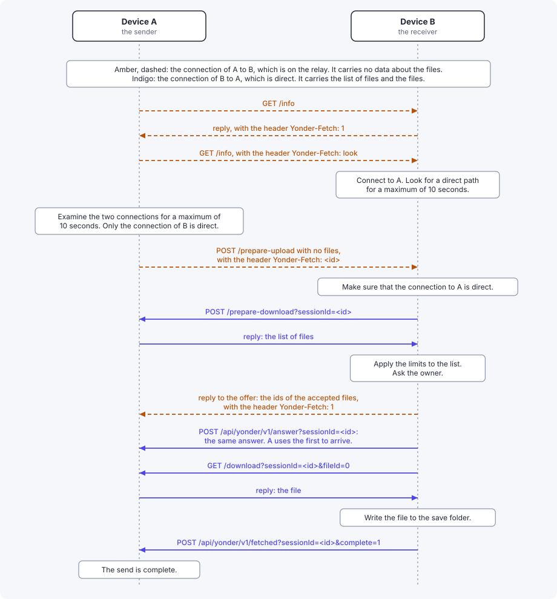

*Figure 4. A sends to B. The connection of A stays on the relay, and the connection of B is direct.*

1. An app that can get files says so: its answer to `GET /info` through the tunnel has the header `Yonder-Fetch: 1`. The web app does not say it.
2. Before a send to such an app, the sender sends one more `GET /info`, with the header `Yonder-Fetch: look`. The receiver then connects to the sender and looks for a direct path on its own connection, for a maximum of 10 seconds. It does one such search at a time for one device. The sender does not wait for an answer about the search.
3. The sender examines the two connections during its one wait. For its own connection, it asks the other device through the tunnel. For the connection of the receiver, its own tunnel server gives the answer.
4. If only the connection of the receiver is direct, the sender sends an offer (`/prepare-upload`) that lists no files, with the header `Yonder-Fetch: <id>`. The id is a random number for this one send.
5. The receiver makes sure that its own connection to the sender is direct. It waits a maximum of 10 seconds for this. If the connection is not direct, the receiver refuses the offer with the header `Yonder-Fetch: no-path`. It does not ask its owner. The sender then shows the message that the two networks do not connect directly. The receiver does not count this offer in its limit of offers from one address (section 6.3), because the offer caused no question to its owner.
6. The receiver asks the sender for the list of files, on its own connection (`POST /prepare-download?sessionId=<id>`). It applies the limits and the name rules of section 6.3 to the list. Then it shows the offer to its owner, as for each offer. If the sender answers 404, the sender does not see the connection of the receiver as direct: the receiver refuses the offer as in step 5. Steps 5 and 6 together have a maximum of 20 seconds, because the receiver accepts no other offer during this time.
7. The receiver answers the offer: the ids of the files that it accepts, with the header `Yonder-Fetch: 1`. The answer contains no file name. The receiver also sends the same answer on its own connection (`POST /api/yonder/v1/answer?sessionId=<id>`), because the connection of the sender can be slow. An answer with no file ids is a refusal. The sender uses the answer that arrives first.
8. The receiver gets each accepted file on its own connection (`GET /download?sessionId=<id>&fileId=<file id>`), one file at a time. The code that writes an uploaded file also writes this file. Thus the name rules, the progress and the result are the same. The receiver refuses each upload (`/upload`) for this send, because the files must come on its own connection.
9. The receiver sends a closing message (`POST /api/yonder/v1/fetched?sessionId=<id>&complete=1`, or `complete=0` if it stopped). The send then ends at the sender. If the receiver sends no request for 1 minute and no file is in transfer, the sender stops the send. If the sender sent each accepted file fully and no closing message comes for 10 seconds, the closing message is lost: the send ends as successful.

The sender or the receiver can stop the transfer as in section 6.3. The sender sends `/cancel` on its own connection. The receiver stops, and its closing message says `complete=0`.

**What each connection carries.**

| Connection | Path | What it carries |
|---|---|---|
| Of the sender | Can be on the relay | The two `/info` requests, the offer with no files, the answer with the ids of the accepted files, and `/cancel` |
| Of the receiver | Direct | The list of files (names, sizes, types), a copy of the answer of the receiver, the files, and the closing message |

Thus the relay carries no data about the files, and not their names. It carries only the fact that a send is necessary, an id, and the answer of the receiver.

**What the sender gives.** The sender gives the list of files and a file only when all these conditions are true. All other requests get the answer 404.

- The request comes through the permanent tunnel, and the tunnel proves that it is from the paired device that got the offer.
- The connection of that device is direct at the time of the request.
- The request has the id of a send that is in progress.
- For the list: it was not given before. For a file: the receiver accepted the file, and the file was not given before.

The sender applies the first three conditions to the answer of the receiver on its own connection and to the closing message.

**The requests.** `/prepare-download` and `/download` are requests of the download mode of the LocalSend protocol. In that mode the receiver starts and the owner of the sender accepts. In a fetched send the sender starts with an offer, and the owner of the receiver accepts. The answer on the connection of the receiver and the closing message are from Yonder. A LocalSend app does not get these requests or the header `Yonder-Fetch`, because two apps use them only through the tunnel.

## 8. The data channel: a transfer with a web app

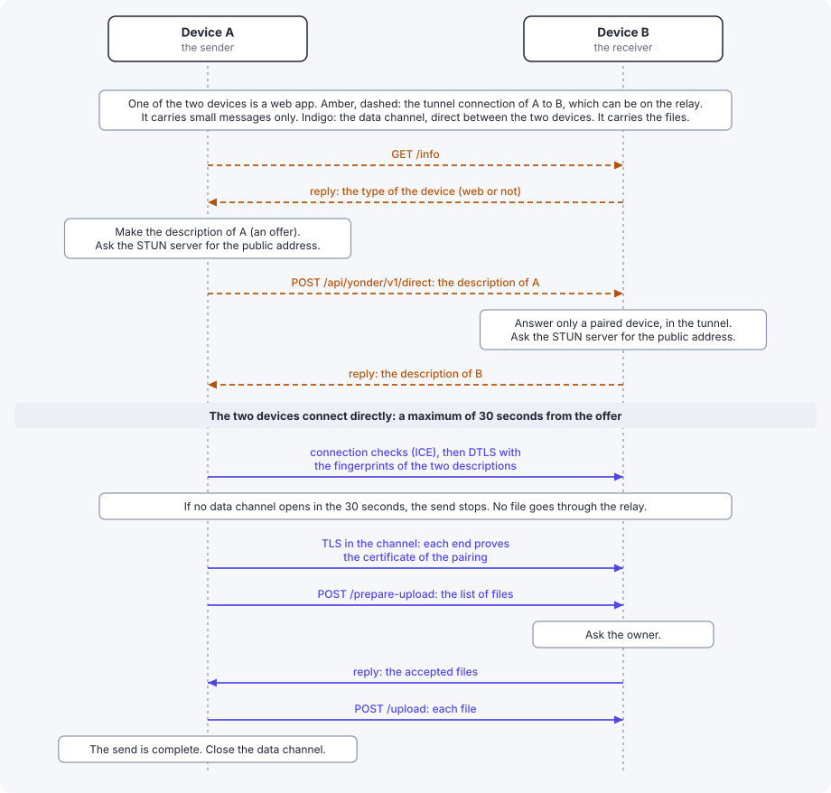

*Figure 5. A sends to B, and one of the two is a web app. The tunnel carries the two descriptions. The data channel carries the files.*

A browser can make a direct connection to a different device with WebRTC. Such a connection is a data channel. A transfer between a web app and a paired device uses a data channel and nothing else: if no data channel forms, the send stops. Two apps do not use data channels; they use the tunnel (section 7.5).

**The sequence.**

1. The sender reaches the other device through the tunnel (section 10). The answer gives the type of the other device.
2. If one of the two devices is a web app, the sender makes a description (an offer). It sends the description through the tunnel, with the request `POST /api/yonder/v1/direct`. The answer is the description of the receiver.
3. The two devices try to connect. All of this, from the offer to the open channel, has a maximum of 30 seconds (`channelWait`). The time is long because a telephone on a mobile network that is occupied can be slow.
4. If the channel opens, each connection of the send is a data channel. The same TLS and the same LocalSend requests operate in it (section 4). The sender closes the channel after the send.
5. If no channel opens, the send stops. The sender shows: "Could not send to (name). The two devices could not connect directly, and Yonder does not pass files through its server. Try again." The sender made no offer of files.
6. If the other device does not know the request, it answers with status 404. The send stops with: "Could not send to (name). Its Yonder is older and cannot connect directly. Update Yonder there, or reload its page."
7. If the channel fails during a send, the send fails as a lost connection does. The path does not change during a send.

**The sender offers.** There is one rule for the two directions. The sender is the end that knows when a transfer starts. The receiver handles the channel as one more listener of its server. A fetched send is between two apps only, thus it has no data channel.

**Who gets an answer.** The receiver answers the request only on a connection of the permanent tunnel that the tunnel proves is from a paired device. Each other request gets status 404: a request on the local network, a request from a key that is not paired, a request with a different method, and a request that arrives on a data channel. The receiver answers 403 when it knows that the two devices are apps.

**The limits of the request, for each paired device.**

| Limit | Value | Answer above the limit |
|---|---|---|
| Size of a description | 16 KB | 413 |
| Data channel connections at one time, open or not yet open | 4 | 429 |
| Requests in one minute | 20 | 429 |

A send makes one request, thus a person does not reach these limits.

**What proves the other device.** A connection that arrives on a data channel is from paired device D only when these three conditions are true.

1. The channel came from a description that arrived in the request, and the request arrived in the tunnel on a connection that the tunnel proves is from D. WebRTC connects only to the DTLS fingerprint in that description.
2. TLS operates in the channel. The receiver demands a client certificate, and its fingerprint must be the fingerprint of the pairing with D. The sender examines the certificate of the receiver as on each path. This TLS is never left out: Yonder does not trust the DTLS layer alone.
3. D is in the list of paired devices when each request arrives. When the user removes the pairing, Yonder closes the channels of D.

A data channel carries uploads only. These things continue to need the tunnel itself: a new address or a new start of a device (section 10), a request for a data channel, an offer for a fetched send, and a file that a device gives in a fetched send. A receiver refuses an upload from a web app that arrives through the tunnel and not on a data channel.

**The STUN server.** To make a direct connection, each device must know its public address. It asks a STUN server. The STUN server is Yonder's own: `stun.getyonder.org`, UDP port 3479 (`stunServer` in `channel.go`; section 13.4). The app and the web app get the address from this one constant, because the web app is the same Go code. The STUN function of the relay (section 7.4) cannot do this work: it answers only a request from the code of Tailscale, and a browser cannot send such a request.

- Each of the two devices asks the STUN server at each transfer with a web app. The app also asks it, not only the web app.
- The STUN server sees the public address of the device that asks. It sees no file, no name, and not the other device.
- **The fall-back.** If the description of a device has no address from Yonder's STUN server, the device drops that description and makes a second one with the STUN server of Cloudflare, `stun.cloudflare.com:3478` (`stunFallback` in `channel.go`; `Config.Fallback` in `internal/direct`). Each device decides this for itself. Cloudflare then sees the public address of that device. The send log records it. The reason for the fall-back is that a fault of Yonder's server must not stop the transfers between two networks. A device whose checks have found a path to the other device before its description is complete keeps that description and does not ask the fall-back server. This occurs when the two devices are on one network: a browser stops its request to the STUN server when it has a path, and its description then has no address from that server.
- The fall-back costs the time that the first description waited: 3 seconds at most in the app and 5 seconds at most in a browser, from the 30 seconds for a data channel.
- A device cannot see why it got no address. Thus a device also asks the fall-back server when Yonder's server answered but the answer gave no new address (a device that has a public address of its own), and when the network of the device lets no UDP through.
- If the two STUN servers give no answer, a device offers only its own addresses. Then a data channel forms only when the two devices are on one network.
- The two paired devices see the addresses of each other, because they connect directly. This is also true for two apps on a direct path.

**No relay for a data channel.** WebRTC can use a relay of its own type (a TURN server). Yonder uses none, and `internal/direct` refuses a configuration that has one. The names of devices on the local network (mDNS) are off in the app.

**What the user sees.**

- While the channel forms, the bar of the send shows "Connecting to (name)…". When the channel is open and the other device is asked, the bar shows "Waiting for (name) to accept 1 file".
- While a transfer moves on a data channel, a green chip "Direct" shows. Its hint is: "This is going straight between the two devices, not through a relay."
- When a transfer with a web app ends, its line ends with one more word: "Sent 1 file to Desk. Direct."

**The send log.** An app writes the path of each transfer with a web app.

| End | Line |
|---|---|
| Sender | `send to "B": path: data channel after 2.86s (host to prflx)` |
| Sender | `send to "B": path: none, refused, because no data channel formed in time` |
| Receiver | `direct: data channel with "A" open after 70ms (host to prflx)`, then `closed after` with the time |
| Receiver | `receive from "A": path: data channel, admitted: true` |
| Receiver | `direct: "A" asked for a data channel, refused: too many` (or `its description is too long`, or `both devices are apps`) |

The words in brackets give the type of address at each end: `host` (an address of the device), `srflx` (the public address from the STUN server), or `prflx` (a public address that the checks found).

**A relay path that is not in use.** The code contains a path that sends the files of a web app through the relay when no data channel forms. It is behind one constant, `relayFallBack` in `channel.go`, which is `false`. Its tests operate with the constant set to permit it. The header `Yonder-Relayed` and the word "Relayed." are parts of that path, and no build shows them.

**The library.** The data channel comes from `pion/webrtc` (v4.2.26, with `pion/dtls` v3.1.15), a WebRTC library in Go. Section 14 gives the reason for this dependency.

## 9. Pairing

A pairing gives each device the record of the other device. After a pairing, each device permits the client key of the other device in its permanent tunnel.

### 9.1 Pairing by link

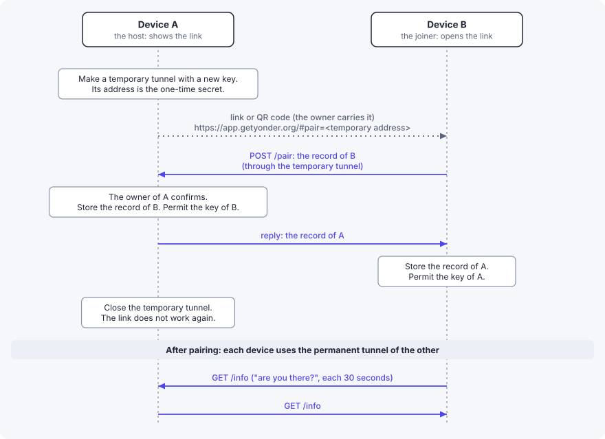

*Figure 6. Pairing by link. The address in the link is a one-time secret.*

1. Device A opens a temporary tunnel with new keys.
2. Device A shows the address of that tunnel as a link and as a QR code. The link is `https://app.getyonder.org/#pair=<address>`. The app reads only the part after `#pair=`.
3. The user moves the link to device B. For example, the camera of a phone reads the QR code.
4. Device B connects to the temporary tunnel and sends its record (`POST /pair`).
5. Device A shows the name of device B. The owner of device A confirms.
6. Device A stores the record of device B and permits its client key.
7. Device A sends its own record as the reply.
8. Device B stores the record of device A and permits its client key.
9. Device A closes the temporary tunnel. The link does not operate again.

The link operates one time, for 10 minutes, and only while device A shows it. The pairing window of device A says this below the link, with the minutes that remain.

If the pairing fails, device B tells its user which step failed:

| What failed | What device B found |
|---|---|
| The tunnel of device B is not open | Device B has no connection to a relay. |
| Device A was not reached | Device B could not connect to the temporary tunnel. Device A is offline, or it does not show the link. |
| Device A was reached, but no answer came | The owner of device A did not confirm in 2 minutes, or the connection stopped. |
| Device A refused | The owner of device A said no, or the link was used before, or its time ended. Device A gives the same answer in these three conditions, thus device B cannot tell them apart. |
| Device A could not store the record | Step 6 failed. |
| Device B could not store the record | Step 8 failed. Device A has stored device B, thus the user must unpair device B on device A before a new attempt. |

A pairing through the meeting point (section 9.2) shows one sentence for all failures.

**The relay in the link.** A tunnel address contains its relay (section 7.2). Thus the address in a link can name any host, and a link can come from any person. Before device B connects, it makes sure that the address is on a relay in the list of relays (`Addr.Listed` in `internal/tunnel`, called by `Node.Join`). If it is not, device B connects to nothing and says: "Could not pair: that link does not use Yonder's relay. Make a new link on the other device." The pairing through the meeting point and the pairing by code go through the same function, thus the check applies to them also. The check does not compare the name of the relay only. An address can also give the IP address of its relay and the name of its certificate. Thus device B writes the address again for each relay in the list, with its own data for that relay, and the result must be the same text as the address in the link.

Three properties protect the link:

- A browser does not send the part of an address after `#` to a server. Thus the server of the web app does not see the secret.
- A temporary tunnel pairs with only one device.
- The web app does not pair automatically when it opens a link. The user must select "Pair".

**A device that is paired keeps its key.** A pairing with the fingerprint of a paired device and a different tunnel key is refused until the user removes the old pairing.

### 9.2 Pairing through the meeting point

A web page cannot search the local network. Thus each Yonder connects to the meeting point, at `wss://api.getyonder.org/nearby`. The meeting point puts the devices in groups by public address: one group for each IPv4 address or each IPv6 /64 block. Devices at the same home router are in one group. A device that Yonder finds in this way shows a "Pair" button.

The meeting point passes all messages between the two devices. Thus the design must keep two promises:

- The meeting point must not see a pairing link.
- The meeting point must not be able to put itself between the devices and stay hidden.

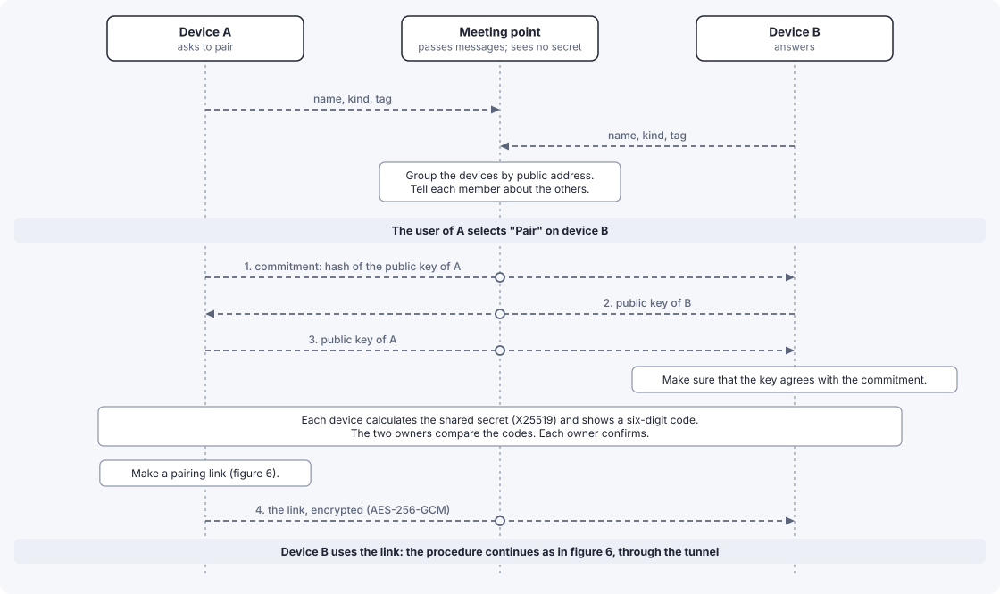

*Figure 7. Pairing through the meeting point. A circle shows a message that the meeting point only passes on.*

1. Device A sends a hash of its public key. This is the commitment.
2. Device B sends its public key.
3. Device A sends its public key. Device B makes sure that the key agrees with the commitment.
4. Each device calculates a shared secret (X25519). From the secret, each device calculates a six-digit code (HKDF-SHA-256) and shows it.
5. The two owners compare the codes. Each owner confirms.
6. Device A makes a pairing link, as in section 9.1. It encrypts the link with the shared secret (AES-256-GCM) and sends it.
7. Device B decrypts the link and uses it. The procedure continues as in figure 6. Device A does not ask its owner a second time.

If the meeting point replaces the keys, the two devices show different codes. The meeting point must select its false key before it sees the key of device A (the commitment). It cannot try many keys in one attempt until the codes agree. Each attempt has one chance in 1,000,000.

**Limit of attempts.** A meeting point that an attacker controls could start many attempts with the asked device, and stop each attempt before the owner is asked. Thus the asked device counts the attempts that stop before it asks its owner. After 3 such attempts in one minute, it refuses all requests for 5 minutes. The count is for the device as a whole, because the meeting point selects what a request says about its sender. An attempt counts when it starts, and the device does only one attempt at a time. A bad meeting point can use this limit to stop pairing for some time. This is accepted, because it can also refuse to carry the messages.

**What a device tells the meeting point:** its name, its kind (browser or app), its version of Yonder, and a tag. The tag is a hash of a random value and the fingerprint of the device. A device that knows the fingerprint recognises the tag. Thus it does not show the same device two times. The random value changes for each connection, so the meeting point cannot use the tag to follow a device.

**Limits of the meeting point:**

| Item | Limit |
|---|---|
| Devices in one group | 32 |
| Devices in one block of addresses (IPv4 /24, IPv6 /48) | 64 |
| Devices in one wide block of IPv6 addresses (/32) | 256. One person can have thousands of /48 blocks, thus the limit for a block is not sufficient for IPv6. IPv4 has no wide block. |
| Devices in all groups | 2000 |
| Messages for one device | 40 each minute |
| Messages for one group | 240 each minute. The meeting point discards a message above this limit, and the sender stays connected. |
| Size of one message | 4 KB |
| Connections that have not said hello | 1024. A connection has 10 seconds to say hello. When 1024 connections wait, a new connection ends the connection that waited longest. Thus a flood of connections that stay silent does not keep a new device out: a device says hello immediately. |
| Groups in memory | 20,000. A group with no device stays for one minute. At 20,000 groups, the meeting point removes each group that has no device. |

The meeting point keeps its data only in memory.

**The meeting point and browsers.** A browser tells the origin of its page with each WebSocket request. The meeting point accepts a browser only when the origin is the origin of the web app, `https://app.getyonder.org` (from `address.WebApp`), or the host name that was asked for. A page of each other site gets status 403. Thus no other site can use the meeting point from the browser of a visitor. An app sends no origin, and this rule does not apply to it.

### 9.3 Pairing by code

Two devices on different networks are not in one group at the meeting point. Their owners can speak to each other, but possibly they cannot send a link or show a QR code. For this condition, the meeting point has rooms. The dialog "Pair a device" has a tab "Use a code".

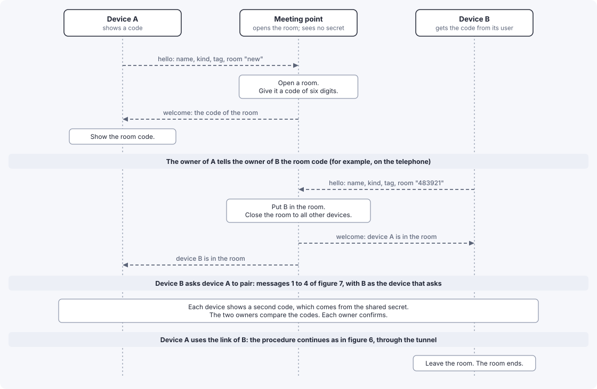

*Figure 8. Pairing by code. Device A shows the room code and device B gets it from its user.*

1. The user of device A selects "Show a code". Device A makes a second connection to the meeting point and asks for a room. The meeting point opens a room and gives it a room code of six digits. Device A shows the room code.
2. The user of device A tells the room code to the user of device B.
3. The user of device B types the room code and selects "Pair". Device B makes a connection to the meeting point and asks for the room with that code.
4. The meeting point puts device B in the room and closes the room to all other devices. Each of the two devices is now the only nearby device of the other.
5. Device B asks device A to pair. The procedure is that of section 9.2, with the same messages, the same dialog, and the same limit of attempts. Each device shows a compared code. The two owners compare the codes, and each owner confirms.
6. Device B makes the pairing link and sends it encrypted. Device A uses it, as in figure 6.
7. Device B leaves the room when its part is complete. The room ends.

**The room code is not the protection.** The room code only brings the two devices together. The meeting point knows each room code, and a person can guess one. The protection is the compared code, as in section 9.2. A person who guesses a room code gets only as far as a stranger at a shared public address: the owner of device A sees a question with a compared code that the other owner does not have. Thus the two owners must compare the codes before they confirm.

**The second connection.** The connection for a room is not the connection that shows a device to nearby devices. Thus pairing by code operates when the setting "Show this device to others on the same network" is off. The devices in a room are not in the group of their address, and nearby devices do not see them.

**The rules of a room:**

| Item | Rule |
|---|---|
| Room code | 6 digits. The meeting point selects it at random, and two open rooms do not have the same code. |
| Devices in one room | 2. A third device gets the answer "no room". |
| Life of a room with one device | 10 minutes, the same as a pairing link |
| Life of a room with two devices | 10 minutes after the second device came. A pairing takes less time. |
| End of a room | When one of the two devices leaves. The room code does not operate again. |
| Open rooms for one connection | 1 |
| Open rooms for one address (IPv4 address, IPv6 /64) | 4 |
| Open rooms for one block of addresses (IPv4 /24, IPv6 /48) | 8 |
| Open rooms for one wide block of IPv6 addresses (/32) | 32 |
| Devices in rooms | A device in a room is counted in the limits of section 9.2 for its block of addresses (64), for its wide block (256) and for all devices (2000). |
| Open rooms in all | 200 |
| Wrong room codes from one address | 30 in 10 minutes. Then the meeting point refuses each room code from that address for 10 minutes, the correct code included. |
| Wrong room codes from one block of addresses (IPv4 /24, IPv6 /48) | 120 in 10 minutes. Then the same refusal for the block. |
| Wrong room codes from one wide block of IPv6 addresses (/32) | 1200 in 10 minutes. Then the same refusal for the wide block. |
| Counts of wrong room codes | A maximum of 30,000. The meeting point makes a count only for a wrong room code, and removes old counts one time each minute. While the list is full, the meeting point does not count a wrong room code from an address that has no count, and it refuses nobody for this cause: a device with the correct room code gets in. |

The meeting point gives the same answer, "no room", for a room code that no room has, for a room that has two devices, and for a room that ended. Thus an answer tells a person who guesses nothing about the rooms. With 30 attempts in 10 minutes for one address, and 1,000,000 possible codes, a person who guesses needs much time to find one open room. Then the compared code stops that person.

A device in a room that ended hears of it when it next sends a message. Each device sends a message at least each 25 seconds (the answer to a ping).

**The last message.** When the meeting point ends a connection, it first sends a message that gives the reason (`bye`), and then it closes the connection with the same reason. A web page cannot read the reason of a close through the library that Yonder uses. Thus the devices read the message.

**Messages of the app to the user:**

| Condition | Message |
|---|---|
| No room has the code, the room is full, or the room ended | "No device shows that code. Check the code; it works once, for 10 minutes." |
| Too many wrong codes | "Too many wrong codes from this network. Wait 10 minutes, or pair with a link instead." |
| No room is free | "Too many codes are in use just now. Try again in a few minutes." |
| The other device left before the pairing was complete | "(name) left. Pair again with a new code." |
| The room waited 10 minutes | "This code has ended. Show a new one." |

**What the meeting point learns** is the same as for nearby devices: the public addresses of the two devices, their names, the time, and that the two devices asked to pair. It does not see the pairing link, the tunnel addresses, or the keys. It keeps the rooms only in memory and writes nothing about them.

## 10. Presence and the address refresh

### 10.1 Presence

A device asks each paired device `GET /info` through the tunnel each 30 seconds. The answer gives four things:

- The device is online.
- Its name at this time. Thus a new name arrives at the paired devices.
- Its type (app or web app). The rules in sections 7.5 and 8 use the type.
- If it can get files in a fetched send (section 7.6). This is a header of the answer, not a part of the LocalSend data.

Two paired devices also tell each other their version of Yonder. The header `Yonder-Version` goes with each `/info` request through the tunnel, with its answer, and with each offer (`/prepare-upload`). Its value is the version, for example `0.1.41`. A development build sends `dev`. The web app sends the version that it was built with.

- The device keeps the version of each paired device in memory only. It writes a line to the send log when it first gets a version and when the version changes.
- Text that is not three numbers or `dev` is the same as no version.
- The hello to the meeting point has the same version, in the field `version`. The meeting point sends it to the other devices with the name and the kind. It does not keep it and does not count it.
- **The use.** A send to a paired device fails. If that device told an older version than this device, the line about the failure ends with "The other device has an older Yonder (version). Updating it may help." There is no such text when the other owner declined, when the other device was busy, when a person stopped the send, or when one of the two is a development build. Nothing is refused.

A tunnel connection that a device keeps can become unserviceable with no error, for example when the other device starts again. Thus Yonder always makes a real request before it trusts a connection. If the request on a kept connection fails, Yonder tries one new connection. The request on a kept connection has a maximum of 4 seconds.

A device tells when it starts again. Each `/info` request through the tunnel contains the header `Yonder-Start`, with a random word that the device makes at each start. When a paired device sends a different word from its last word, the device that hears it closes its kept connection to that device and makes a new connection immediately, unless a transfer uses the connection. The device believes the header only on a connection that the tunnel proves is from that paired device.

A device that does not answer shows as offline. An offline device and a device that removed the pairing look the same.

### 10.2 The address refresh

The home relay is a part of the tunnel address. Thus, when the home relay of a device changes (section 7.2), the device gets a new address. Paired devices must find each other again without a new pairing. Yonder has two methods.

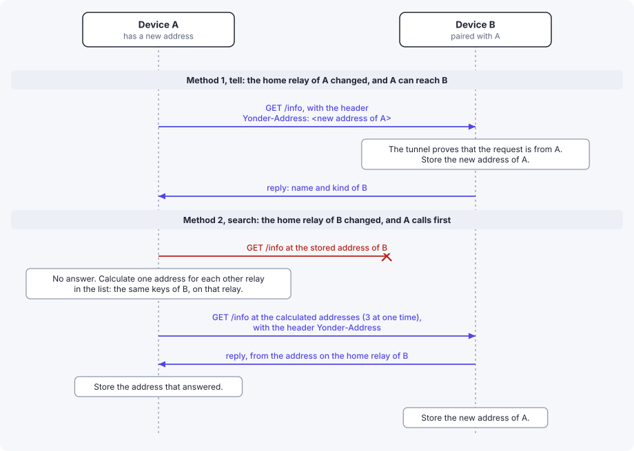

*Figure 9. The two methods of the address refresh.*

**Method 1: tell.** Each `/info` request through the tunnel contains the tunnel address of the caller, in the header `Yonder-Address`. If the address is different from the stored address, the other device stores it. The device believes the header only on a connection that the tunnel proves is from that paired device. On the local network, the device ignores the header. The new address must contain the same tunnel keys as the stored address, and its relay must be in the list of relays. The check of the relay is `Addr.Listed` (section 9.1), which compares the full address and not only the name of the relay. This method adds no request.

**Method 2: search.** The keys of a device do not change with the relay. Thus the address of a device on a different relay is the stored address with that relay. When a device gets no answer at the stored address of a paired device, it does a search:

1. It calculates one address for each relay in the list, but not for the relay of the stored address.
2. It asks `GET /info` at these addresses, a maximum of 3 at one time.
3. The first address that answers is the new address. The device stores it and stops the other requests.
4. If no address answers, the paired device shows as offline.

The device does only one search for one paired device at a time. A second caller waits. If the first search found an address, the second caller uses it.

Each method is necessary:

| Condition | Method that operates |
|---|---|
| The home relay of device A changed. Device A can reach device B at its stored address. | Tell |
| The home relay of device B changed. Device A calls first, and gets no answer at the old address of B. | Search |
| The home relays of the two devices changed. Neither can reach the old address of the other. | Search |

## 11. How Yonder selects the path for a send

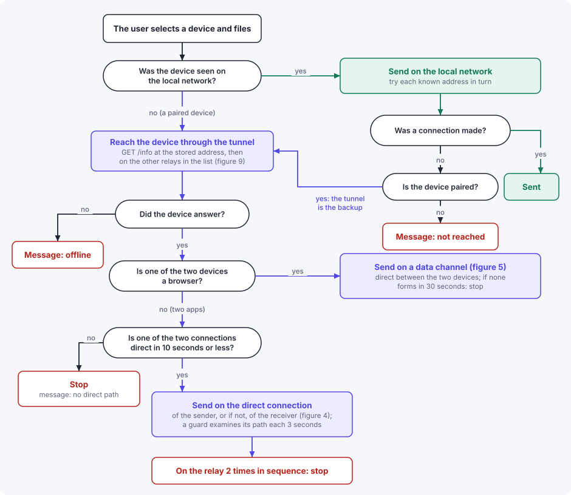

*Figure 10. The decisions for one send, from the top to the bottom.*

1. If the device is nearby, Yonder sends on the local network. This is the fastest path.
2. If no connection can be made there and the device is also paired, Yonder sends the same files through the tunnel. A firewall or unusual routing can break the local path when the tunnel still operates.
3. If the device is paired and not nearby, Yonder uses the tunnel.
4. Through the tunnel, Yonder first reaches the device (section 10). If one of the two devices is a web app, the files go on a data channel, and the send stops if none forms in 30 seconds (section 8, figure 5).
5. Between two apps, Yonder applies the rule for the relay (section 7.5). The files go on the connection of the sender if it is direct. If it is not, they go on the connection of the receiver if that one is direct (figure 4).

## 12. The web app

The web app is the same program as the app. The Go code is compiled to WebAssembly and operates in the page.

### 12.1 One interface, two shells

The interface is plain HTML, CSS, and JavaScript. It has no framework and no build step. The app and the web app share `index.html`, `app.css`, and `app.js` (`cmd/yonder/frontend`). Each shell supplies two small files:

| File | In the app | In the web app (`cmd/yonder-web/page`) |
|---|---|---|
| `bridge.js` | Calls Go through the Wails window | Calls Go in WebAssembly |
| `shell.css` | Empty | The layout of a website, from phone to desktop |

The Go side sends the full `State` to the interface after each change. Each `State` has a sequence number, and the interface ignores a late one. Thus the interface has only one procedure to draw the screen.

### 12.2 A file system for the browser

The WebAssembly build of Go reads and writes files through an object that the page supplies. The page of Yonder supplies such an object (`files.js`). It keeps the configuration files in the storage of the browser (`localStorage`). Thus the packages that operate on the desktop operate in the browser with no changes. The object supplies only the functions that Yonder uses. The Go tests do not use this object.

### 12.3 A folder for received files

Some browsers can give a folder of the computer to a page (the function `showDirectoryPicker`): at this time, Chrome, Edge and Opera on a computer. Firefox and Safari cannot. The page examines the browser at each start and does not use its name.

In a browser that can give a folder, Settings shows the line "Save received files to" with the buttons "Choose…" and "Stop". In other browsers the line is not shown.

- **To select the folder.** "Choose…" opens the folder dialog of the browser. The browser gives the page the name of the folder and the permission to write into it. It does not give the path.
- **To keep the folder.** The page keeps the folder in the IndexedDB store of the browser. If the user clears the data of the site, the folder is forgotten. "Stop" removes it.
- **To save a file while it arrives.** Go writes a received file to a part file, and gives the file its name when it is complete and the checksum is correct. When Go writes the first piece of a part file, the file system of the page asks the bridge for a place for the pieces (`divert` in `files.js`, `take` in `bridge.js`). If a folder is selected and the permission is given, the bridge makes a file with that part name in the folder and opens it for writing. Then each piece goes to the folder when Go writes it, and the page does not keep the piece in memory. Go waits for each write, thus the pieces cannot collect in the page. When Go gives the file its name, the page closes the file in the folder and gives it the same name there. If the folder has a file of the same name, the new file gets the name "name (1).ext", then "name (2).ext", as in the app. The page never writes over a file.
- **If the receive stops.** If the sender or the user cancels, or the checksum is incorrect, Go removes its part file. Then the page drops the content and removes the part file from the folder. If a write into the folder fails during the receive, the page does the same, shows a message with the cause, and gives Go an error. Go then stops the receive, and the sender sees that the file did not arrive. If the user closes the page during a receive, an empty part file stays in the folder.
- **To save a file that is in memory.** If the bridge cannot open a file in the folder when the first piece comes (no folder, no permission, or an error), the file arrives in memory. When such a file has fully arrived, the page writes it into the folder (`keepAll` and `keepOne` in `bridge.js`), one file at a time, with the same rule for the name. Then the page releases the content from its memory.
- **After the save.** The row in the Received list shows "Saved" in the position of the "Save" button.
- **A new permission.** At a later visit, a browser can ask for the permission again. The page cannot ask without a click of the user. Thus the Received list shows a notice with the buttons "Allow…" and "Not now". Until the user gives the permission, received files stay in memory as they do with no folder. After "Allow…", the page writes the files that wait into the folder.

The page adds two items to the state that Go sends, before the interface gets it: `folder` and, for each received file, `kept`. Go does not know about the folder. The interface is the same file for the app and the web app; in the app, `folder` is absent and nothing changes.

**With no folder.** A received file stays in the memory of the page until the user selects "Save", which saves it as a download. A completed receive stays on the Devices page with a "Save" button until the user selects "Dismiss" or opens a different tab. If the user closes the page first, the files are lost.

With a folder and its permission, a file does not stay in the memory of the page while it arrives, thus a file can be larger than the memory that the browser gives the page. With no folder, a file must be smaller than that memory.

### 12.4 Differences from the app

| Subject | Web app |
|---|---|
| Path | The files go on a data channel, directly between the two devices (section 8). The tunnel connection stays on the relay and carries small messages only. |
| Service | The web app calls the service at `api.getyonder.org`, or at the address that the file `service.json` gives (section 3.2). At each start it makes one request for `/opened`, for the count (section 13.2). |
| Home relay | Always the main relay. The web app does not get the list of relays. Thus it does the search of section 10.2 only on the main relay. A paired device on a different relay must tell the web app its new address. |
| Local network | No discovery, and no exchange with LocalSend apps. A browser cannot use multicast. |
| Nearby devices | Only through the meeting point |
| Pairing | By link, through the meeting point, and by code, as in the app |
| Received files | Section 12.3 |
| Update check | None. The browser loads the newest web app at each visit. The web app shows no version number. |
| Tabs | Only one tab can operate Yonder, because two tabs would share one identity. |
| Screen of a telephone | A browser stops a page when the screen of a telephone locks, and a transfer stops with the page. While a transfer is in progress and the page is in view, the page asks the browser to keep the screen on (the Screen Wake Lock interface, in `bridge.js`). A browser can refuse, and some browsers do not have the interface. Thus each transfer also shows the text "Keep this page open until this is done. On a phone, keep the screen on too." |
| Monthly limit | When the application server reaches its monthly limit, the meeting point accepts no browser (section 13.3). Then the web app cannot pair by code and shows no nearby devices. The page continues to open, and paired devices continue to operate. |

## 13. The server programs

This repository contains two server programs of Yonder: the application server `yonder-api` and the STUN server `yonder-stun`. The relay is `derper`, a program from Tailscale that Yonder does not change. The files of the web app are plain files, and each server of files can supply them.

### 13.1 The application server

`yonder-api` (`cmd/yonder-api`) supplies the service and nothing else. One function (`known`) decides which host names get an answer.

| Host name | Start option | Addresses |
|---|---|---|
| The names of the service, for example `api.getyonder.org` | `-api-hosts` | `/nearby` (the meeting point, a WebSocket), `/relays.json` (the list of relays, section 7.2), `/latest.json` (the newest version of the app, section 5.4), `/status.json` and `/opened` (refer to the paragraphs below). Each other address gives status 404. |
| `localhost`, `127.0.0.1`, and each name of `-hosts` | `-hosts` | The same addresses, for local tests |
| Each other name | | Status 403 |

It obeys these rules for each request:

- It answers only the exact addresses of the table. It supplies no folder of files. `//relays.json` gives status 404.
- A request has time limits: 10 seconds for the headers, 30 seconds for the request, 1 minute for the answer, and 2 minutes for a connection without a request. The limits do not apply to the meeting point.
- A maximum of 1024 connections can be open with no request made. When 1024 such connections wait, a new connection ends the connection that waited longest. The time limits do not limit the number of these connections, and nginx limits only the connections of one address.
- Each answer has these headers:

| Header | Value |
|---|---|
| `Content-Security-Policy` | `default-src 'none'; frame-ancestors 'none'` |
| `Strict-Transport-Security` | `max-age=31536000` |
| `X-Content-Type-Options` | `nosniff` |
| `Referrer-Policy` | `no-referrer` |

The service has no page. Thus its policy permits nothing to a browser that opens an answer as a page.

**The address of the visitor.** The meeting point needs the public address of each device to make its groups. When a proxy is in front of `yonder-api`, the option `-proxy` makes the program read that address from a first line that the proxy adds to each connection (the PROXY protocol, `internal/proxyline`).

**The meeting point.** Sections 9.2 and 9.3 give its function, its limits, and its rule for browsers. The option `-app-origins` adds origins of copies of the web app at a different name.

**The web app's start.** The web app makes one request for `/opened` at each start. The answer has status 204 and no contents. `yonder-api` counts the request as one start of the web app only when its header `Origin` is an origin of the web app. For such a request, the answer has the header `Access-Control-Allow-Origin` with that origin.

**The status for the homepage.** `/status.json` tells if browsers can use the meeting point, and if not, until which day (section 13.3). Its two fields are `open` and `until`. The homepage of the website asks it, to show a line to its visitors when the monthly limit is reached. That request comes from a page of a different origin. A browser lets a page read such an answer only if the answer permits it. Thus `yonder-api` puts two headers on the answer:

- `Vary: Origin`, on each answer to `/status.json`.
- `Access-Control-Allow-Origin` with the origin of the website (from `address.Website`), only when the header `Origin` of the request has exactly that value. The value is never `*`.

No other address gets this header for the website. Thus a page of a different site cannot read the list of relays or the update check. `yonder-api` does not count this request.

**A release of the service.** The script `packaging/api.sh` makes the folder `dist/api` with two files: `relays.json` and `latest.json`. `yonder-api` reads them from the folder that the option `-dir` gives. A `latest.json` with a new version number must go out only after the packages of that version are available for download.

### 13.2 What the application server counts

`yonder-api` counts some events as totals for each day (`internal/tally`). The option `-tally` gives the folder of the totals; without it, the program counts nothing. The totals are in a SQLite file, `tally.db`.

| Event | What is added to the totals of the day |
|---|---|
| A start of the web app (`/opened`) | One start, with the country and the state or province that the request came from |
| An update check (`/latest.json`) | One check, with the version of the app, its system and the country; and, apart from the version and the system, with the state or province |
| A pairing through a room or between nearby devices | One room opened; one pairing started; one pairing completed |

These rules apply to the count:

- A total has no address, no cookie, and no identifier of a device or of a person.
- The program uses the address of a request only to find a place. It looks for the address in a file of address ranges on its own disk (`-tally-places`), adds one to the total, and writes no address. It asks no other service. Without the file, the place stays empty. The option `-places-build` makes the file from the list "IP to City Lite" of DB-IP. The file has the country and the state or province of each range, and nothing finer.
- The program accepts only a known version and a known system from an update check. Other text is not counted.
- The meeting point counts a pairing from the messages that it passes. It does not count names or room codes.

The privacy page of the website (<https://getyonder.org/privacy/>) lists all that Yonder's own service counts.

### 13.3 The monthly limit

The option `-limit-gb` gives `yonder-api` a limit for the data that the server sends in one month (`internal/usage`). The program reads the count of sent bytes of one network interface (`-usage-iface`) one time each minute and keeps the total of the month in a file (`-usage-file`). The value 0 gives no limit. Yonder's own service operates with a limit.

No file goes through the relay, thus the traffic of a month is small: the small messages of the tunnels, the meeting point, and the files of the web app for each first visit. The limit stays as a protection against cost.

When the server reached the limit:

- The meeting point turns browsers away until day 1 of the next month. A web app then cannot pair by code and shows no nearby devices.
- The page of the web app continues to open. A web app continues to send to and receive from its paired devices.
- `/status.json` tells that browsers cannot use the meeting point, and until which day.
- The apps continue to operate.

### 13.4 The STUN server

`yonder-stun` (`cmd/yonder-stun`, package `internal/stun`) tells a device its public address. A device sends a STUN Binding request (RFC 8489) on UDP. The program answers with the address and the port that the request came from. It does no other thing. It is a program of its own, not a part of `yonder-api`, so that a program that is open to the internet stays small. The code is Yonder's own, approximately 100 lines; no library reads the packets.

| Item | Value |
|---|---|
| Name | `stun.getyonder.org`. The name can move to a different server with no new version of the app. |
| Port | UDP 3479 (the option `-listen`). The relay keeps UDP 3478. |

**What it answers.** Only a Binding request of 20 to 512 bytes with the correct length. It does not read the attributes of a request. It answers nothing to all other packets. It has no TURN function.

**The limit.** One source gets 60 answers in 10 seconds. A source is an IPv4 address, or the /64 network of an IPv6 address. The program holds no address. It has a table of 262,144 counts, and a hash of the source gives the place of the source in the table. The key of the hash is random and changes each time the program starts. The table cannot become full, thus a flood of requests with false senders does not stop the answers to new sources. Two sources can have the same place; they then share one limit. All counts go back to zero when the 10 seconds end. A request with a false sender makes the program send at most 2.2 times the bytes that it got (an answer is 32 or 44 bytes; a request is 20 bytes or more).

**What it keeps.** It writes no file. For the limit, it holds the addresses of the last 10 seconds in memory, and then drops them. One time each hour it writes one line to its log: the number of requests that it answered and the number that it did not. The line has no address.

### 13.5 A copy of Yonder with servers of its own

A person can build and operate all of Yonder from this repository. These are the locations that tie a build to Yonder's own servers:

| Item | Location |
|---|---|
| The service, the web app and the website | `internal/address` |
| The main relay | `tunnel.Relay` in `internal/tunnel`, and `cmd/yonder-api/files/relays.json` |
| The STUN server and its fall-back | `stunServer` and `stunFallback` in `internal/app/channel.go` |
| The public key for the list of withdrawn versions | `internal/withdrawn/withdrawn.go`. `yonder-withdraw -newkey` makes a new key. |

A copy of the web app alone needs less: the file `service.json` names the service (section 3.2), and that service must permit the origin of the copy with `-app-origins`. Such a copy has its own identity and its own pairings in a browser, because a browser keeps the data of a page for each site address.

A relay must accept connections on port 443, because the app takes only such relays from the list (section 7.2).

## 14. The code

Yonder is one Go module, `yonder`.

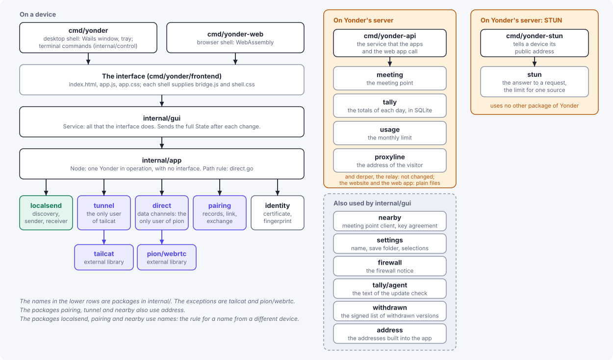

*Figure 11. Each box calls only boxes below it. The programs for the servers are in the panels at the right.*

| Package | Function |
|---|---|
| `cmd/yonder` | The desktop window (Wails v3), the tray, and the terminal commands |
| `cmd/yonder/frontend` | The interface that the app and the web app share (section 12.1) |
| `cmd/yonder-web` | The WebAssembly program for the browser, and the files of its shell (`page/`) |
| `cmd/yonder-api` | The application server (section 13.1): the service, the meeting point, the monthly limit, the count |
| `cmd/yonder-api/files` | The list of relays, `relays.json` |
| `cmd/yonder-stun` | The program for the STUN server (section 13.4) |
| `cmd/yonder-withdraw` | Signs the list of withdrawn versions, makes the key, and writes `latest.json` for `packaging/api.sh` (section 5.4) |
| `internal/address` | The addresses of Yonder's servers that the app contains (section 3.2) |
| `internal/gui` | `Service`: all that the interface shows and does, as one `State`. It has no window in it, so tests can operate it. |
| `internal/control` | The socket of the app for terminal commands, and the JSON list that `yonder devices -json` prints |
| `internal/app` | `Node`: one Yonder in operation, with no interface. Pairing, reach, address refresh (with the search for a moved device), and the rule for the relay are here. `channel.go` has the request for a data channel, its limits, and the STUN server (section 8). |
| `internal/direct` | A data channel as a network connection (`net.Conn`), and the end that accepts as a listener (section 8). No other package uses pion. |
| `internal/localsend` | The LocalSend protocol: discovery, sender, receiver. The two ends of the fetched send are also here: the receiver that gets the files, and the lender that gives them. |
| `internal/tunnel` | tailcat behind Yonder's own types: the tunnel, the list of relays, and the home relay. No other package uses tailcat. |
| `internal/pairing` | The records, their storage, the link, and the exchange |
| `internal/names` | The rule for a name that a different device sent (section 6.1): `Clean` and `Bad`. It imports no other package of Yonder. |
| `internal/identity` | The certificate and its fingerprint |
| `internal/nearby` | The client for the meeting point, the client for a room, and the key agreement |
| `internal/meeting` | The meeting point (server side), with its groups and its rooms |
| `internal/settings` | The name, the save folder, and the selections of the user |
| `internal/firewall` | Reads the condition of the firewall on each operating system |
| `internal/usage` | Counts the bytes that the server sends in a month (section 13.3) |
| `internal/tally` | The count (section 13.2): the totals of each day in a SQLite file, and the place of an address. Only the application server uses it. |
| `internal/tally/agent` | The text that an app sends with its update check (section 5.4), and the function that reads it. It is apart from `internal/tally` so that the app and the web app do not contain SQLite; a test makes sure of this. |
| `internal/stun` | For `yonder-stun`: the answer to a STUN request, and the limit for one source. It imports no other package of Yonder. |
| `internal/proxyline` | Reads the address of the visitor that a proxy supplies (section 13.1) |
| `internal/withdrawn` | The signed list of withdrawn versions, its public key, and the check of a list (section 5.4). It is apart from `internal/gui` so that `yonder-withdraw` and `api.sh` use the same code and key without the app. |

**The scripts** are in `packaging/`. `build.sh` makes the packages for Linux, Windows and macOS, and the file `SHA256SUMS`. `api.sh` makes the release of the service, and `webapp.sh` makes the files of the web app. Each operates without the others. `licences.sh` makes the file with the licences of the software that Yonder contains.

Four rules keep the structure simple:

- **One rule, one location.** For example: the name of the main relay is in `tunnel.Relay`, the list of relays is in `tunnel.Relays`, the addresses of the servers are in `internal/address`, the rule for a name from a different device is in `internal/names`, and the address sequence is in `Sender.connect`.
- **tailcat stays in one package.** If tailcat changes, only `internal/tunnel` changes.
- **pion stays in one package.** Only `internal/direct` uses it.
- **The interface has no logic.** It draws the `State` and calls `Service`.

**Dependencies.** The rule of the project is: no new dependency without a written reason.

| Dependency | Reason |
|---|---|
| `tailscale/tailcat` (with `tailscale.com`) | The tunnel between two networks, with no account and no changes to the operating system |
| `wailsapp/wails` v3 | The native window and the tray icon, with the interface as a web page. Thus the app and the web app share one interface. |
| `pion/webrtc` v4 | A browser can make a direct connection to a different device only with WebRTC. Thus the other end, the app, must also speak WebRTC, and the web app in WebAssembly must operate the WebRTC of the browser from Go. To write the protocols again (ICE, DTLS, SCTP) is not a sensible alternative. |
| `coder/websocket` | The connection to the meeting point, in the app, in WebAssembly and in the server |
| `modernc.org/sqlite` | The totals of the count. It has no C code. It is in `yonder-api` only, never in the app or the web app. |

These conditions apply to the use of `pion/webrtc`: TLS with the certificate of the pairing always operates in the channel; only the stable v4 line is used; the advisories of pion are read before each release; the part that a different device can reach stays small (mDNS is off); and a fault of the library must stop one transfer, not the app. The last condition is not fully met (section 16).

## 15. Security summary

| Item | Protection |
|---|---|
| File contents | Encrypted from device to device: TLS, in WireGuard in the tunnel or in DTLS on a data channel. No file goes through a server of Yonder. |
| Identity of a sender | Proved by its TLS certificate, not by a name |
| Who can connect through the tunnel | Only client keys that the device permits |
| Tunnel address | A secret. It moves only in a pairing, and through the tunnel. |
| Pairing link | A one-time secret. The part after `#` does not go to a server. The link asks the owner about one device only, and it stops after 10 minutes. |
| The relay in a pairing link | The app connects only if the full address is on a relay in the list of relays (section 9.1). |
| Pairing through the meeting point | Key agreement with a commitment, and a code that the owners compare (section 9.2) |
| Pairing by code | The room code only brings two devices together. The protection is the same key agreement and compared code. The meeting point limits wrong room codes, and a room takes only two devices (section 9.3). |
| A paired device | The app believes "paired" only on a connection that comes in through the tunnel. A device that is paired keeps its tunnel key: a pairing with the same fingerprint and a different key is refused until the user unpairs. |
| A data channel | Made only from descriptions that go through the tunnel between two paired devices. TLS in the channel proves the certificate of the pairing at each end. A data channel carries uploads only (section 8). |
| Files that a device gives in a fetched send | Only to the paired device that got the offer, on a connection that the tunnel proves and that is direct. Only the files that the device accepted, one time each, while the send is in progress. All other requests get 404 (section 7.6). |
| An offer for a fetched send | Accepted only through the tunnel from a paired device. The list of files has the same limits and name rules, and the owner gets the same question. |
| A received file | Limits and name rules of section 6.3. "Open" does not run a program. |
| A name from a different device | One rule, `names.Clean`: no control characters, no characters that change the direction of the text, a maximum of 64 characters. The app applies it before it keeps or shows the name (sections 6.1 and 6.3). |
| What a device on the local network can make the app keep | A maximum of 16 KB for each `/register` request, short names, and a maximum of 16 devices from one address (section 6.1) |
| Announcements on the local network | An announcement cannot change a device with TLS to a device without TLS. An announcement cannot change the name in the row of a paired device. A paired device is listed only with TLS. A device without TLS shows the tag "Not encrypted" (section 6.1). |
| Address refresh | Believed only on a connection that the tunnel proves is from the paired device |
| The list of relays | A maximum of 16 relays, port 443 only, plain DNS names only (section 7.2) |
| The update notice | It opens only an `https://` page at the host name of the website (section 5.4). |
| The notice about a withdrawn version | The app accepts the list only with a signature from a key that is not on the server, and only if the list is not older than the list that it has (section 5.4). The notice warns and stops nothing. |
| The version that a device tells | Only three numbers or the word `dev` are accepted, from a paired device through the tunnel or in the hello to the meeting point. Other text is ignored. |
| The meeting point and browsers | It accepts a browser only from the origin of the web app. A page of a different site gets status 403 (section 9.2). |
| The files of the web app | The host of these files selects the code that operates in the browser, with the keys of the pairings. Thus the web app has a host name of its own, which the website does not control. |
| The website and the application | The website supplies no code that the app or the web app uses. The application server lets a page of the website read one answer only, `/status.json`, which is not a secret (section 13.1). |
| The send log | Only the owner can read it. It has a maximum size of 1 MB. A different device cannot make a line long, start a line of its own, or put a file name in it (section 5.2). |
| The socket for terminal commands | Only the owner can open it. A program of the owner can list the devices and send files, as it can with the terminal commands. It cannot read keys or addresses through the socket. |
| The packages | `packaging/build.sh` writes the file `SHA256SUMS` with the checksum of each package. The packages are not signed. |

**What Yonder's servers can see:** the internet addresses of connected devices, the times, and the quantity of data of the tunnel messages that the relay passes. This quantity does not include files. At the meeting point, the application server also sees the names and the versions of Yonder of devices that are at the same public address, and the names and room codes of devices in a room. The STUN server sees the public address of a device that asks.

**What Yonder's servers cannot see:** file contents, file names, the sizes of files, pairing links, and tunnel addresses.

**What other parties can see.** Two paired devices see the addresses of each other. While Yonder's STUN server answers, no other company sees the address of a device at a transfer with a web app. When it gives a device no address, that device asks the STUN server of Cloudflare, which then sees the address of the device (section 8).

**Risks that stay.**

- A device with the tag "Not encrypted" gets files without TLS (section 6.3). The tag is the only warning.
- The app removes a nearby device from its list when the device does not answer. Thus, while a device that uses TLS is not on the network, a different device can announce its fingerprint without TLS. The app then lists the different device with the name that it gives, and with the tag "Not encrypted". This cannot occur for a paired device.
- A sender that does not obey the rule for the relay (changed software) can send through the relay after the receiver accepted its offer on a direct path, because only the sender has a guard during an upload (section 7.5).
- A paired device can keep the one transfer of the receiver occupied for most of each minute with offers for a fetched send that it does not complete (each offer keeps it for a maximum of 20 seconds, 3 each minute). An offer that the owner does not answer does the same for 5 minutes.
- Many persons can have one public address: some mobile networks and some internet providers put thousands of customers behind a small number of IPv4 addresses, and an office or a school can do the same. These persons share one count of wrong room codes and one limit of 4 open rooms. A person at the same public address, or in the same block of addresses, can thus stop pairing by code for that address on purpose, at a small cost. During the refusal, the meeting point refuses the correct room code also. Nobody gets a pairing or a file in this way, and pairing by link continues to operate.
- One person with many blocks of IPv4 addresses, or with many wide blocks of IPv6 addresses, can fill the meeting point or the rooms. Pairing through the meeting point then stops for new devices while that person continues. Paired devices continue to operate. The same person can fill the list of counts of wrong room codes; the meeting point then does not count the wrong room codes of new addresses, and refuses nobody for this cause.
- A flood of announcements on the local network can keep new devices out of the list of nearby devices for 10 minutes.
- A bad meeting point can stop pairing through the meeting point (section 9.2). It cannot complete a pairing that the two owners did not confirm.
- If the app cannot write `withdrawn.json`, it keeps the accepted list in memory only. After the next start, it accepts an older signed list again.

## 16. Known limits

- **Some networks permit no direct connection.** These are networks with hard NAT, for example some mobile networks, and networks that let no UDP through (section 7.4). With such a network at one end or at the two ends, a send between two networks can stop, because Yonder does not pass files through its server. The fetched send helps when one of the two tunnel connections is direct (section 7.6). It is not known how many networks permit no direct path, for the tunnel or for a data channel.
- **A browser cannot pause a data channel that sends to it.** Bytes that arrived and that the page did not read stay in memory, with no limit. Thus a web app that receives a large file from a fast sender can use much memory.
- **A fault in the WebRTC library can stop the app.** A panic in a goroutine of the library stops the program. The package `internal/direct` catches panics only in its own callbacks.
- **In a browser, the browser decides most settings of a data channel.** Yonder cannot set them.
- **A web app without a selected folder keeps received files in memory** (section 12.3). The files are lost if the user closes the page before a save.
- **A page stops when the screen of a telephone locks** (section 12.4).
- **The packages are not signed.** Windows and macOS show a warning at the first start. The file `SHA256SUMS` lets a person examine a download, and a person can build the app from this repository.
- **There is one relay.** The apps can use a list of relays (section 7.2), but at this time the list has only the main relay. The home relay does not go back automatically to a relay that operates again.
- **The receiver does one transfer at a time** (section 6.3).
- **An offline device and a device that removed the pairing look the same** (section 10.1).
- **There are no phone apps.** On a phone, Yonder operates as the web app.
- **tailcat gives no promise of stability.** Its interface and its wire format can change. Thus its version is fixed, and only one package uses it (section 7.1).
